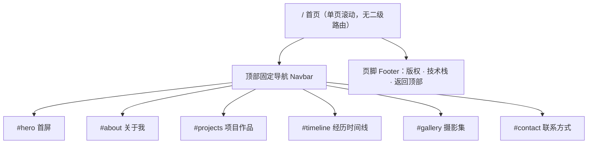
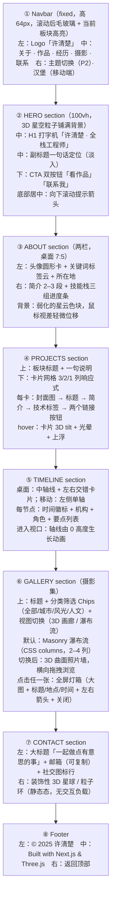

# 个人门户网站 PRD（简单版）

| 项目 | 内容 |
| --- | --- |
| 文档语言 | 中文 |
| 项目名称 | `my_home_page` |
| 技术形态 | Next.js 15（App Router）+ TypeScript + Tailwind CSS + Three.js（react-three-fiber / drei） |
| 视觉风格 | 3D 沉浸式（星空/粒子场景、鼠标视差、滚动驱动 3D） |
| 内容状态 | 全量占位示例内容，集中管理于单一数据配置文件 |
| 文档版本 | v1.0 |
| 作者 | 许清楚（产品经理） |

> **UI 组件选型说明**：本站点为高度定制的 3D 视觉站点，UI 组件**不引入 MUI**，改用 Tailwind CSS 自建组件，避免 MUI 默认样式与 3D 沉浸视觉冲突、并控制包体体积。

---

## 1. 产品定义

### 1.1 一句话定位

> 一个以 3D 星空粒子为视觉主线的个人门户站点，用沉浸式的滚动叙事集中展示许清楚的专业身份、作品集、成长经历与摄影审美。

### 1.2 产品目标

| 目标 | 描述 | 衡量指标 |
| --- | --- | --- |
| G1 建立专业第一印象 | 访客在首屏 5 秒内理解「我是谁、我做什么、我的能力边界」 | 首屏一次性呈现姓名/职业/定位/CTA；LCP ≤ 2.5s（4G 移动端） |
| G2 高效传递可信证据 | 通过技能栈、项目作品集、经历时间线三类硬信息，支撑访客做「是否联系我」的判断 | 5 大板块均可直达，任意板块 ≤ 2 次交互可达；项目卡可跳转外链 |
| G3 呈现审美与个性 | 通过 3D 场景与摄影集传递个人审美，形成差异化记忆点 | Hero 3D 场景、摄影 3D 画廊各 1 套；低端设备可降级但不白屏 |

---

## 2. 目标用户与使用场景

| 用户角色 | 特征 | 核心诉求 |
| --- | --- | --- |
| 招聘方 / HR / 技术负责人 | 移动端或桌面端快速浏览，停留 1–3 分钟 | 30 秒定位技术栈、项目亮点、联系方式 |
| 潜在客户 / 合作方 | 关注交付能力与作品质量 | 看作品集与经历，评估可信度后发起联系 |
| 同行开发者 | 会审视技术实现细节、开控制台看性能 | 视觉与技术是否过硬、是否有源码可参 |
| 亲友 / 泛访客 | 被分享链接带入，设备性能参差 | 好看、不卡顿、能看懂、找得到联系方式 |

**典型场景**

1. 招聘方在手机上打开分享链接 → 首屏看到「许清楚 · 全栈工程师」打字机标题 → 下滑看技能栈与项目 → 点击「联系我」发邮件。
2. 合作方在桌面端浏览 → 鼠标移动触发星空视差 → 项目卡 hover 浮起 → 进入摄影集 3D 画廊感受审美 → 通过页脚社交链接联系。
3. 低端安卓机访客 → WebGL 检测失败 → 自动降级为 CSS 渐变星空 + 静态内容，所有信息完整可读。

---

## 3. 用户故事

| ID | 用户故事 |
| --- | --- |
| US-1 | 作为**访客**，我希望在首屏立刻看到站点主人的姓名、职业和不被打断的视觉冲击，以便我在 5 秒内决定要不要继续往下看。 |
| US-2 | 作为**招聘方**，我希望技能栈按类别和熟练度可视化呈现，以便我快速判断技术匹配度。 |
| US-3 | 作为**潜在客户**，我希望每个项目都有截图、技术标签和在线/源码链接，以便我评估交付质量并直接访问 demo。 |
| US-4 | 作为**同行开发者**，我希望看到按时间倒序排列的经历时间线，以便我了解其职业成长路径。 |
| US-5 | 作为**泛访客**，我希望摄影集支持点击放大查看大图并键盘翻页，以便我沉浸式欣赏作品。 |
| US-6 | 作为**访客**，我希望导航栏常驻并能高亮当前所在板块，以便我随时跳转而不迷路。 |
| US-7 | 作为**站主（我）**，我希望所有文案、项目、照片都集中在一个配置文件里，以便我改一处就全站生效，无需碰组件代码。 |
| US-8 | 作为**移动端访客**，我希望 3D 效果不影响阅读和滚动流畅度，以便我在低端机上也能完整获取信息。 |

---

## 4. 需求池

优先级定义：**P0 = 必须有（基础可用）**，**P1 = 应该有（3D 增强与动效）**，**P2 = 可以有（可选增强）**。

### 4.1 P0 —— 基础可用（共 12 条）

| ID | 需求描述 | 验收标准 |
| --- | --- | --- |
| P0-01 | 站点骨架：Next.js App Router 单页应用，Semantic HTML 分区（header/main/section/footer），`lang="zh-CN"` | 5 大板块渲染为 5 个带 `id` 与 `aria-label` 的 `<section>`；无 hydration 警告 |
| P0-02 | 固定顶部导航栏：Logo + 5 个锚点 + 移动端汉堡菜单 | 桌面端横排常驻；≤768px 出现汉堡按钮并可展开/收起；点击锚点平滑滚动到位（≤800ms） |
| P0-03 | Hero 首屏：姓名 + 职业 + 一句话定位 + 双 CTA（看作品 / 联系我）+ 向下滚动提示 | 首屏 100vh 自适应；无 3D 时仍有 CSS 渐变星空背景，文字完整可读 |
| P0-04 | 打字机标题：姓名与职业轮换打字 | 逐字输出 60–90ms/字，行末光标 1s 闪烁；停留 2s 后删除（40ms/字）切换下一句；`prefers-reduced-motion` 下直接展示静态文本 |
| P0-05 | 关于我：头像 + 简介段落（2–3 段）+ 个人关键词标签 | 头像圆形裁切，alt 文本完整；简介支持换行段落；标签 ≥5 个 |
| P0-06 | 技能栈：按「前端 / 后端 / 工具与设计」分组，每项含名称与熟练度 | ≥3 个分组、每组 ≥3 项；熟练度以进度条 + 百分比数字双呈现（无障碍可读） |
| P0-07 | 项目作品集：卡片网格，含封面图、标题、一句话简介、技术标签、Demo/源码链接 | 示例项目 ≥3 个；桌面 3 列 / 平板 2 列 / 手机 1 列；外链 `target="_blank" rel="noopener noreferrer"` |
| P0-08 | 经历时间线：按时间倒序，含时间区间、机构/公司、角色、要点描述 | 示例经历 ≥4 条；桌面端中轴线布局，移动端左侧单轴布局；时间点带标记圆点 |
| P0-09 | 联系方式：邮箱 + 社交链接（GitHub / 微博 / 微信 / 知乎）+ 可复制邮箱按钮 | 点击邮箱唤起邮件客户端；复制按钮有「已复制」反馈（2s 后复位） |
| P0-10 | 摄影集：Masonry 瀑布流网格 + 点击灯箱放大 | 示例照片 9 张，分「城市 / 风光 / 人文」三类；灯箱支持上一张/下一张、ESC 关闭、点击遮罩关闭；键盘 ←/→ 翻页 |
| P0-11 | 单一数据配置文件：所有文案、技能、项目、经历、照片、联系方式集中一处 | 修改该文件任一字段 → 重启/热更新后全站对应位置生效；文件内附 TypeScript 类型定义与中文注释 |
| P0-12 | 响应式适配与页脚 | 断点 640/768/1024/1280 全部无横向滚动条；页脚含版权、建站技术栈说明、返回顶部按钮 |

### 4.2 P1 —— 3D 增强与动效（共 9 条）

| ID | 需求描述 | 验收标准 |
| --- | --- | --- |
| P1-01 | Hero 3D 星空粒子场景：约 3000 个粒子组成的星云，缓慢自转与漂移 | Canvas 铺满首屏、`pointer-events:none`；粒子数按设备分级（桌面 3000 / 移动 1200）；帧率目标 ≥50fps |
| P1-02 | 鼠标视差：鼠标位置驱动相机/星云轻微位移与景深变化 | 相机偏移使用 lerp 阻尼（系数 0.05），最大位移不超过视口 3%；鼠标停止后 200ms 内归于稳定，无抖动 |
| P1-03 | 滚动驱动 3D：随页面滚动，星云相机推进并切换星云密度/色调 | 滚动进度 0→1 映射相机 z 轴推进；各板块背景色随滚动插值过渡；不影响原生滚动条手感 |
| P1-04 | 摄影集 3D 画廊模式：可切换的 3D 环形/曲面照片墙 | 提供「3D 画廊 / 瀑布流」切换按钮；3D 模式下照片沿曲面排布，滚轮或拖拽横向浏览，点击弹出灯箱；切换状态不丢失 |
| P1-05 | 滚动进场动画：板块标题与卡片随进入视口淡入上移 | IntersectionObserver `threshold=0.2`，触发一次；同组元素 stagger 80ms；`once:true` 不重复播放 |
| P1-06 | 项目卡 hover 3D 倾斜（tilt）与光晕 | 鼠标位置驱动卡片 rotateX/rotateY 最大 ±8°，带 200ms 回弹过渡；触摸设备自动禁用 |
| P1-07 | 技能进度条进入视口后动画填充 | 从 0 填充至目标百分比，时长 800ms，ease-out；reduced-motion 下直接显示终值 |
| P1-08 | 3D 分级降级策略 | 三级降级：① 无 WebGL 或 `prefers-reduced-motion: reduce` → 纯 CSS 渐变 + 静态星点，不加载 Three.js；② 低端设备（`deviceMemory<4` 或移动端）→ 降粒子数、关闭后处理；③ 完整体验。降级时全部信息仍可访问 |
| P1-09 | 3D 性能保护 | 页面切到后台或 Canvas 滚出视口时暂停渲染循环；组件卸载时释放 geometry/material/texture；无内存泄漏（连续进出 10 次内存增长 <10%） |

### 4.3 P2 —— 可选增强（共 7 条）

| ID | 需求描述 | 验收标准 |
| --- | --- | --- |
| P2-01 | 暗色 / 亮色主题切换 | 按钮切换并持久化到 localStorage；刷新后保持；两套配色对比度均达 AA |
| P2-02 | 中英文 i18n 切换 | 文案抽离为语言包；切换后全站文案更新，`lang` 属性同步 |
| P2-03 | 访客统计（PV/UV、来源） | 接入轻量统计；后台可见数据；不影响 LCP（异步加载） |
| P2-04 | 博客 / 笔记板块（MDX） | 支持 Markdown 文章列表与详情页，路由 `/blog/[slug]` |
| P2-05 | 在线简历 PDF 下载 | 页脚或关于我提供下载按钮，PDF 由同一数据配置生成 |
| P2-06 | 首屏 Loading 过渡动画 | 3D 场景加载完成前显示进度动画，完成后淡出；加载 >3s 则跳过动画直接展示 |
| P2-07 | 联系表单（无需后端，接入第三方表单服务） | 表单校验 + 提交成功提示；失败有错误提示 |

---

## 5. 信息架构

### 5.1 站点导航结构



> P2 阶段若启用博客，追加 `/blog` 与 `/blog/[slug]` 两条路由，导航新增「博客」入口。

### 5.2 五大板块内容要素清单

| 板块 | 内容要素 | 占位示例（用户后续替换） |
| --- | --- | --- |
| **① Hero 首屏** | 姓名、职业（打字机轮换）、一句话定位、双 CTA、滚动提示、3D 星空背景 | 姓名「许清楚」；职业轮换「全栈工程师 / 独立开发者 / 摄影爱好者」；定位「用代码构建体验，用镜头记录光影」 |
| **② 关于我 + 技能栈** | 头像、简介（2–3 段）、所在地、关键词标签、技能分组（名称 + 熟练度 + 分类） | 简介：「8 年 Web 研发经验，专注前端架构与可视化……」；技能：前端（TypeScript 92 / React 90 / Next.js 88 / Three.js 75）、后端（Node.js 85 / Python 78 / PostgreSQL 72）、工具与设计（Git 90 / Docker 76 / Figma 68） |
| **③ 项目作品集** | 卡片：封面图、标题、一句话简介、技术标签、Demo 链接、源码链接、年份 | ① CloudDeck 云资源看板（React/TypeScript/ECharts，2024）② InkFlow 实时协作白板（Next.js/WebSocket/Canvas，2023）③ Lumen 摄影后期助手（Electron/Python/OpenCV，2023） |
| **④ 经历时间线 + 联系方式** | 时间线：时间区间、机构、角色、2–3 条要点；联系：邮箱、社交链接、可复制邮箱 | 经历：「2022–至今 某某科技 · 前端架构师」「2019–2022 某互联网公司 · 高级前端工程师」「2017–2019 某创业公司 · 前端工程师」「2013–2017 某大学 · 计算机科学与技术 学士」；邮箱 `hi@xuqingchu.dev` |
| **⑤ 摄影集** | 照片（图片路径 + 标题 + 分类 + 拍摄地 + 拍摄时间 + alt 描述）、分类筛选、灯箱 | 9 张，分类「城市 / 风光 / 人文」，如「深圳湾日落 · 城市 · 2024 · 深圳」「雪山晨雾 · 风光 · 2023 · 川西」 |

---

## 6. UI 设计稿说明（线框级）

### 6.1 页面区块布局



### 6.2 3D 场景在各区块中的角色

| 区块 | 3D 角色 | 实现要点 |
| --- | --- | --- |
| Hero | **主舞台**：全屏星空粒子，鼠标视差 + 缓慢自转 | 单个 `<Canvas>`（全屏 fixed，`z-index:0`），首屏文字层 `z-index:10`；粒子用 `Points` + 自定义 shader，避免 3000 个 Mesh |
| About / Projects / Timeline | **氛围层**：低密度星点与色雾，随滚动改变色调与相机 z 轴 | 复用 Hero 的同一个 Canvas（避免多个 WebGL context），按滚动进度插值参数；或用固定背景 Canvas 全程复用 |
| 区块转场 | **视觉分隔**：滚动到板块边界时星云加速推进 + 色彩渐变 | 由滚动进度驱动，不使用 scroll hijack，保留原生滚动 |
| 摄影集 | **展示主体**：可切换的 3D 曲面/环形照片墙（P1-04） | 独立 Canvas，仅在该板块进入视口时挂载（懒加载），离开视口卸载；默认仍为瀑布流，保证 SEO 与性能 |
| Contact | **静态装饰**：低多边形星球或粒子环，不可交互 | 复用背景 Canvas 即可，不新增 context |
| 全局 | **降级兜底**：无 3D 时以 CSS 径向渐变 + 静态星点 SVG 替代 | 降级路径下不下载 Three.js 相关 chunk |

### 6.3 视觉基调

- 主色：深空蓝黑 `#050816` → 星际紫 `#1a1040` 渐变；强调色：青蓝 `#4CC9F0`、品红 `#F72585`。
- 字体：中文 `Noto Sans SC` / 英文 `Inter`，字重 400/600/800；H1 桌面 64px / 移动 36px。
- 卡片：半透明玻璃拟态（`backdrop-blur` + 1px 半透明描边），圆角 16px。

---

## 7. 交互与动效规格

| 项目 | 规格 |
| --- | --- |
| 打字机 | 打字 60–90ms/字；换行/换句停留 2000ms；删除 40ms/字；光标 `▌` 闪烁周期 1s；`prefers-reduced-motion` 下仅显示首句静态文本 |
| 滚动进场 | IntersectionObserver `threshold=0.2`，`once:true`；位移 `translateY(24px)→0`，透明度 `0→1`，时长 600ms，`cubic-bezier(0.22,1,0.36,1)`；同容器子元素 stagger 80ms |
| 鼠标视差 | 归一化鼠标坐标 → 目标相机位移，lerp 阻尼系数 0.05；最大位移 ≤ 视口 3%；页面滚动时叠加滚动进度位移 |
| 滚动驱动 3D | `scrollY / (docHeight - vh)` → 0~1 进度，驱动相机 z 轴 0→-8、粒子透明度、背景色插值；`requestAnimationFrame` + 节流，非滚动时不计算 |
| hover 态 | 按钮：上浮 2px + 光晕扩散；项目卡：3D tilt ±8° + 阴影加深（200ms 回弹）；导航项：下划线由 0 展开至 100%；摄影图：轻微放大 1.05 + 遮罩显示标题 |
| 灯箱 | 打开/关闭 200ms 淡入淡出 + 缩放 0.95→1；支持 ←/→ 翻页、ESC 关闭、点击遮罩关闭；打开时锁滚动、焦点移入对话框、关闭后焦点归还触发元素 |
| 页面切换/锚点滚动 | `scroll-behavior: smooth`，时长约 600ms；`prefers-reduced-motion` 下改为 `auto` 瞬时跳转 |
| **3D 降级策略** | **L0**：不支持 WebGL 或 `prefers-reduced-motion: reduce` → 不加载 Three.js，改用 CSS 径向渐变 + 静态星点 SVG，所有动效关闭；**L1**：移动端或 `navigator.deviceMemory < 4` → 粒子数降至 1200，关闭 bloom/后处理，DPR 上限 1.5；**L2**：桌面端完整体验，DPR 上限 2。降级判定在挂载 Canvas 前完成，判定结果不影响任何信息的可读性 |
| 性能保护 | Canvas 滚出视口或 `document.hidden` 时暂停渲染；`frameloop` 按需模式；卸载时 `dispose()` 释放资源 |

---

## 8. 非功能需求

| 类别 | 要求 |
| --- | --- |
| **性能** | 首屏 LCP ≤ 2.5s（4G 移动端）、桌面端 ≤ 1.8s；CLS ≤ 0.1；INP ≤ 200ms。3D 代码分包并 `dynamic(..., { ssr:false })` 懒加载，**不阻塞首屏文本渲染**；Hero 文案服务端渲染直出。图片统一 `next/image`（WebP/AVIF、按需尺寸、`loading="lazy"`，Hero 图 `priority`）。JS 首屏预算 ≤ 200KB gzip |
| **可访问性** | 语义化标签 + 唯一 H1；所有交互元素可键盘聚焦，可见 focus ring；图片必填 alt；正文对比度 ≥ 4.5:1；优先支持 `prefers-reduced-motion`；3D Canvas 标记 `aria-hidden="true"` 并提供等价文字信息；灯箱具备 dialog 语义与焦点陷阱 |
| **响应式断点** | `sm 640` / `md 768` / `lg 1024` / `xl 1280` / `2xl 1536`（Tailwind 默认）。手机：单列、Hero 标题 36px、导航汉堡化、3D 降级 L1；平板：项目 2 列、摄影 2–3 列；桌面：项目 3 列、摄影 3–4 列、时间线中轴布局 |
| **SEO** | 使用 Next.js Metadata API 配置 title/description/keywords；Open Graph 与 Twitter Card（1200×630 OG 图）；`sitemap.xml` + `robots.txt`；JSON-LD `Person` 结构化数据（姓名、职业、邮箱、社交 sameAs）；所有正文内容服务端渲染，不依赖 JS 才能索引 |
| **浏览器兼容** | Chrome / Edge / Firefox / Safari 最近两个大版本；Safari 需额外验证 WebGL 与 `backdrop-filter` 表现 |
| **数据与可维护性** | 全部可替换内容集中于 `src/data/site.config.ts`（含类型定义与中文注释），组件零硬编码文案；图片资源统一放 `public/images/`，命名 `photo-01.jpg` / `project-01.jpg` |
| **部署** | 静态可导出，适配 Vercel 一键部署；构建产物中不含任何密钥 |

---

## 9. 数据配置契约（占位内容集中管理）

> 供架构师/工程师直接落地，字段即为 P0-11 的验收依据。

```
src/data/site.config.ts
├─ profile      { name, titleAlternatives[], tagline, location, avatar, bio[], keywords[], email, socials[] }
├─ skills       { category, items: { name, level(0-100) }[] }[]
├─ projects     { id, title, summary, cover, tags[], demoUrl, repoUrl, year }[]
├─ timeline     { period, org, role, highlights[], }[]
├─ gallery      { id, src, title, category, location, date, alt }[]
└─ nav          { sections: { id, label, href }[] }
```

**占位图片策略**（当前无真实素材）：项目封面与照片使用 `https://picsum.photos/seed/{id}/1200/800` 占位，同时在 `public/images/` 预留同名本地路径约定；用户替换时仅改 `site.config.ts` 中的 `src/cover` 字段即可切换到本地文件。

---

## 10. 待确认问题

| # | 问题 | 影响 | 建议默认值（未回复则按此执行） |
| --- | --- | --- | --- |
| Q1 | 真实姓名、职业、邮箱、社交账号是否现在提供？ | 全站所有文案 | 暂用占位「许清楚 / hi@xuqingchu.dev」，待用户替换 |
| Q2 | 是否需要**联系表单**（P2-07）还是邮箱/社交链接即可？ | 是否需要第三方表单服务与后端依赖 | P0 仅做邮箱 + 社交链接，表单列入 P2 |
| Q3 | 摄影集默认视图是「3D 画廊」还是「Masonry 瀑布流」？ | 首屏性能与视觉优先级 | 默认瀑布流（可切换 3D 画廊），兼顾性能与 SEO |
| Q4 | 是否有真实照片与项目截图？ | 图片占位方案 | 无则使用 picsum 占位图，并预留本地路径约定 |
| Q5 | 是否需要中英双语（P2-02）？ | 文案结构与路由设计 | 一期仅中文，但文案全部集中于配置，便于后续 i18n |
| Q6 | 主题是否固定暗色？ | 配色工作量 | 一期固定深空暗色，亮色切换列入 P2 |
| Q7 | 部署目标平台（Vercel / 静态托管 / 自有服务器）？ | 构建方式（`output: export` 与否） | 按 Vercel 兼容 + 可静态导出实现 |
| Q8 | 是否需要访客统计（P2-03）？ | 第三方脚本与隐私声明 | 一期不接入 |
| Q9 | 3D 视觉强度偏好：偏克制（弱粒子、少动效）还是偏炫技（强视差、强转场）？ | 动效参数与降级阈值 | 偏克制——保证内容与性能优先，3D 作为氛围增强 |

---

## 11. 交付范围说明

- **本期（P0 + P1）**：完整可上线的单页门户站点，5 大板块齐全，3D 沉浸式视觉与降级策略完备，占位内容可通过单个配置文件替换。
- **不在本期范围**：博客系统、后端服务、用户认证、评论系统、真实联系表单、CMS 后台。
